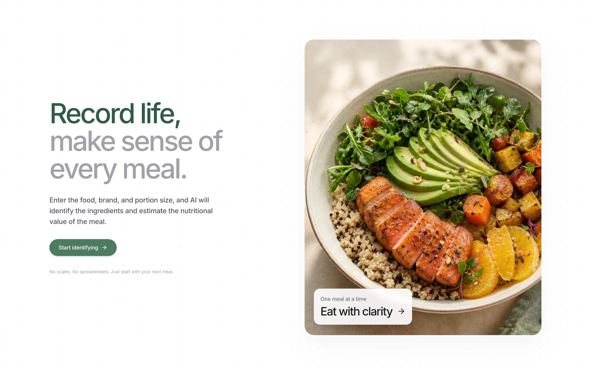
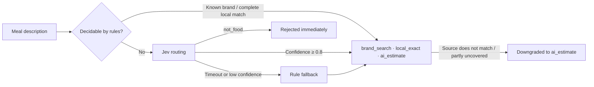

<p align="center">
  <a href="https://fitnessforeverybody.app"></a>
</p>

<h1 align="center">Fitness for Everybody</h1>

<h3 align="center">
  Log a meal in one sentence.<br>
  AI tracks your nutrition, shows your gaps, and plans your next meal.
</h3>

<p align="center">
  <a href="https://fitnessforeverybody.app"></a>
  
  
  <a href="LICENSE"></a>
</p>

<p align="center">
  <a href="https://fitnessforeverybody.app">
    
  </a>
</p>

<p align="center">
  <b>Try it now → <a href="https://fitnessforeverybody.app">fitnessforeverybody.app</a></b><br>
  Free · English and Chinese · Works on phone and desktop
</p>

## Table of Contents

1. 💡 [Why Fitness for Everybody?](#why-fitness-for-everybody)
2. ✨ [Features](#features)
3. 🧠 [How Recognition Works](#how-recognition-works)
4. 🧱 [Tech Stack](#tech-stack)
5. 🗂️ [Project Structure](#project-structure)
6. 🚀 [Getting Started](#getting-started)
7. 📚 [Documentation](#documentation)
8. 🤝 [Contributing](#contributing)
9. 📄 [License](#license)

## Why Fitness for Everybody?

Whether you are building muscle, losing fat or simply trying to eat better, the hardest habit to keep is usually not the training. It is the food log. Traditional trackers ask you to weigh every portion, search long food databases and add up macros by hand, and most people give up within a week. Real meals are also messy: takeaway, canteen lunches, chain-restaurant combos and home cooking rarely match a database entry.

Fitness for Everybody makes logging food as easy as sending a message. Describe what you ate in your own words and let AI do the rest. It tells you whether you have eaten enough today, what is still missing, and what your next meal could be.

It is built for people who:

- are building muscle, losing fat or losing weight and need to watch protein and calories;
- train regularly and want their diet to follow training and rest days;
- have no time to weigh food, but want to know they are roughly on track.

## Features

### 🥗 AI meal recognition

Describe a meal in plain language. The app splits it into individual foods and estimates the nutrition of each one, looking up brands on the web when needed.

- Handles takeaway, chain-restaurant meals, mixed dishes and home cooking, including brands, portions and grams.
- Shows its progress live. Results land in a review list where you can adjust portions before they count toward today.
- Links the public sources and official brand pages it used when it looked something up.
- Adds a short, practical tip to each food.

### 📊 Daily nutrition progress

- Live progress for protein, carbs, fat, calories and fiber, always shown as numbers.
- One daily score that tells you at a glance how today is going.
- Daily targets adapt to your body, your goal, and whether today is a training or rest day.

### 🍽️ Smart next-meal recommendations

- Recommendations follow today's nutrition budget and what is still missing.
- Filter by cuisine, meal slot and style.
- Switches to light top-ups such as fruit or yogurt when you are close to your targets.
- Ask AI for more ideas, or let the shuffle pick one for you.

### 📅 Calendar and settings

- A training and food calendar to look back at what you ate and trained on any day.
- Set up your body profile and goal once; it is remembered, and you can fine-tune daily targets at any time.

### 🔐 Account

- Sign in with your email and a one-time code. No password.
- Your records follow you across devices, and you can delete your account and all data at any time.

> Nutrition values are estimates for everyday guidance, not medical or dietary advice.

## How Recognition Works

Recognition is a routing problem: which function should handle a given meal description?

| Function | Responsibility |
| --- | --- |
| `brand_search` | Retrieves public brand information and extracts structured nutrition data |
| `local_exact` | Matches the built-in nutrition database and calculates exactly from grams or standard servings |
| `ai_estimate` | The fallback when neither of the above matches: an estimate based on industry averages, constrained by prompt engineering (Chinese dining portion baselines and a macro-to-calorie consistency check) |



### Jev routing

Letting an LLM pick the function through function calling means waiting for a full model inference on every decision, which is slow and inefficient. Function selection is handed to Jev instead:

- **Input:** a structured state made of the original sentence, brand hints, and local candidates with their coverage;
- **Judgement:** predefined criteria, such as brand products first and a direct local result only when local coverage is complete;
- **Output:** a probability distribution and a confidence score over four routes.

The system validates the distribution first and accepts only conclusions with a confidence of at least 0.8.

- **Decision separated from generation:** Jev handles routing; the LLM only generates content (reading sources, estimating nutrition) and never chooses tools.
- **Predictive routing:** prediction starts 500 ms after the user stops typing, so the route is ready on submit; input judged not to be food is rejected on submit.
- **Deterministic short-circuit:** a known brand or a complete local match is routed by rules directly, with no request.

### Graceful degradation

- **Brand sources do not match the brand:** the result becomes an estimate, with no sources attached.
- **Local data covers only part of the meal:** matched foods are kept as fixed data, and only the rest goes to `ai_estimate`.
- **Jev times out (2 s) or lacks confidence:** the rules decide.

A failure at any step never interrupts recognition.

### Performance

Average recognition time is about 2.5 seconds, roughly one eighth of letting an LLM choose the functions through function calling.

## Tech Stack

| Layer | Technology |
| --- | --- |
| Frontend | Next.js 14 (App Router), React 18, TypeScript, Tailwind CSS |
| Backend | Next.js API Routes (Node.js) |
| Database | Supabase (PostgreSQL) |

## Project Structure

```text
fitnessforeverybody/
├── src/
│   ├── app/                  # Pages and API routes
│   ├── features/             # Feature modules
│   │   ├── recognition/      # Meal recognition
│   │   ├── recommendation/   # Next-meal recommendations
│   │   ├── profile/          # Body profile and goals
│   │   ├── daily-log/        # Daily progress and calendar
│   │   ├── account/          # Sign-in and account
│   │   └── feedback/         # In-app feedback
│   └── shared/               # Shared logic, components and types
├── data/                     # Static data
├── supabase/                 # Database migrations and tests
├── scripts/                  # Build and test scripts
├── tests/                    # Automated tests
└── .docs/                    # Architecture, code conventions and topic guides
```

Each feature module is split into `domain` (pure business logic), `server` (server-side calls) and `ui` (components).

## Getting Started

If you have cloned this repository, you can run it locally. You need Node.js 22.6 or later.

```bash
git clone https://github.com/thrqz101/fitnessforeverybody.git
cd fitnessforeverybody
npm install
cp .env.example .env    # fill in the values described in .env.example
npm run dev
```

Then open <http://localhost:3000>.

Useful commands:

```bash
npm run typecheck   # type checking
npm test            # tests
npm run build       # production build
```

See [.docs/setup.md](.docs/setup.md) for the full environment setup.

## Documentation

| Document | What it covers |
| --- | --- |
| [architecture.md](.docs/architecture.md) | System overview, directory ownership, layering rules and the main request flow |
| [code.md](.docs/code.md) | Coding conventions: naming, modules, API routes and TypeScript |
| [AGENTS.md](AGENTS.md) | Working rules for AI coding assistants, also useful for human contributors |
| [docs/](.docs/) | Topic guides: recognition, recommendations, nutrition targets, database, i18n, testing, UI, setup and more |
| [CHANGELOG.md](CHANGELOG.md) | Release notes |

## Contributing

Issues and pull requests are welcome. Please read [.docs/code.md](.docs/code.md) and [AGENTS.md](AGENTS.md) first.

1. Create a branch from `main`, for example `feat/your-feature`.
2. Run `npm run typecheck` and `npm test` before committing.
3. Use Conventional Commits, for example `feat(recommendation): ...`.
4. Push your branch and open a pull request describing the change and how you verified it.

## License

[MIT](LICENSE)
